# Style gallery

Generated by `local-designer.mjs styles index` - do not edit by hand. Thumbnails are real renders (seed 42, 768x512 source, 384x256 WebP);
each style uses its own `thumb_subject`, so compare a style with its neighbours of the same category rather than across categories.

## photo

| Preview | Style | Use it for |
|---|---|---|
| 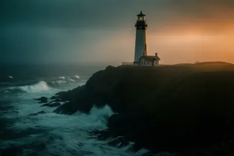 | **cinematic** Film still, dramatic lighting, teal and orange grading, anamorphic feel | hero banner, teaser, storytelling |
| 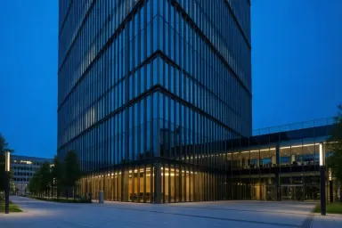 | **corporate-architecture** Modern glass building at blue hour, corrected verticals, brochure quality | headquarters presentation, real-estate brochure, annual report cover, site page |
|  | **corporate-portrait** Professional corporate headshot, soft studio light, blurred office background | team page, leadership bio, press kit, speaker slide |
|  | **corporate-workplace** Candid bright modern office, collaborating colleagues, stock-photography look | about-us page, proposal cover, recruitment, slide background |
| 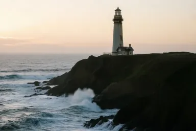 | **photo-realistic** Natural photograph, soft daylight, shallow depth of field | hero image, editorial photo, product shot |
| 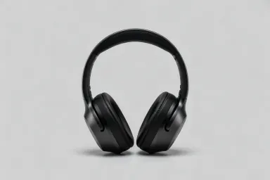 | **product-studio** Studio packshot on a seamless grey backdrop with soft shadows and room for text | product page, catalogue, hardware proposal, spec sheet cover |

## vector

| Preview | Style | Use it for |
|---|---|---|
| 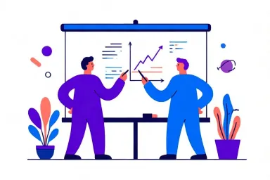 | **corporate-memphis** Flat figures with long limbs and small heads, solid bright colours (tech-company style) | SaaS landing page, onboarding, HR deck, slide illustration |
|  | **flat-vector** Clean flat vector illustration, limited palette, geometric shapes | blog, slide, web illustration, icon set |
| 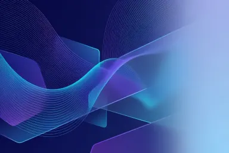 | **gradient-abstract** Modern abstract gradients and glass panels with space for a title (keynote backgrounds) | title slide, website hero background, report cover, event banner |
|  | **icon-flat** Consistent set of rounded glyph icons on white, two colours | slide icons, feature list, web UI, brand kit |
| 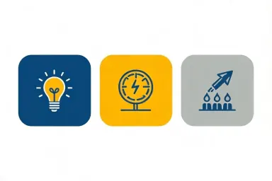 | **infographic-flat** Pictograms in a clear flow, three brand colours, generous white space, no text | roadmap slide, process explanation, KPI slide visual, steps diagram |
|  | **isometric-flat** Flat isometric vector scene, three-tone faces, tech palette (architecture and process visuals) | architecture schema, IT proposal, process overview, landing hero |

## cartoon

| Preview | Style | Use it for |
|---|---|---|
|  | **cartoon-clean** Bold-outline friendly cartoon, flat colours, uncluttered (proposals and explainers) | commercial proposal, explainer, training material, customer guide |
| 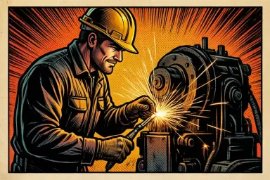 | **cartoon-comic** Comic-book ink and halftone, dynamic composition, no text | storytelling, internal communication, training scenario, case-study story |

## drawing

| Preview | Style | Use it for |
|---|---|---|
| 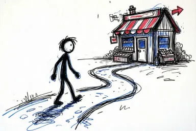 | **doodle-whiteboard** Hand-drawn whiteboard sketchnote, stick figures, arrows, marker accents | workshop, retrospective, training, pitch warm-up |
| 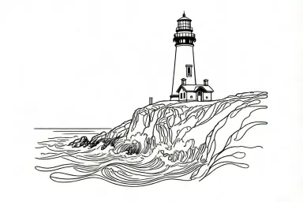 | **line-art** Black ink line drawing on white, no shading | colouring page, logo sketch, light illustration |
| 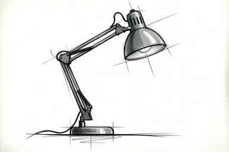 | **sketch-marker** Concept sketch with fine liner and grey markers, one accent colour | concept proposal, early design, workshop board, product ideation |

## technical

| Preview | Style | Use it for |
|---|---|---|
| 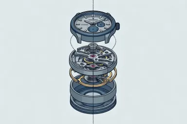 | **exploded-view** Exploded-view technical illustration, dotted guides, soft cel shading (manuals and spec sheets) | user manual, spec sheet, product architecture, service guide |
| 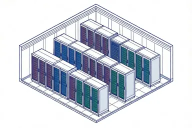 | **isometric-line** Isometric technical line art, thin blue outlines, one accent fill | infrastructure schema, floor plan, site layout, process hall |
| 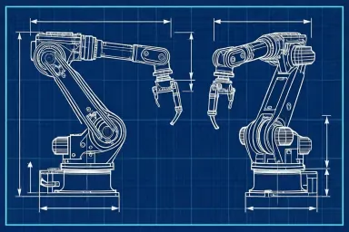 | **technical-blueprint** White linework on blueprint blue, orthographic views, callouts without text | engineering proposal, technical documentation, industrial cover, patent-style figure |

## editorial

| Preview | Style | Use it for |
|---|---|---|
| 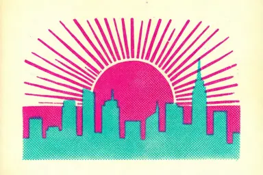 | **riso-duotone** Two-colour risograph print, halftone grain, slight misregistration | poster, editorial header, event flyer, report section opener |

## painting

| Preview | Style | Use it for |
|---|---|---|
| 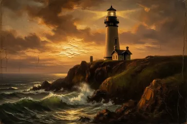 | **oil-painting** Classical oil painting, visible brushwork, rich chiaroscuro | portrait, landscape, premium decor |
| 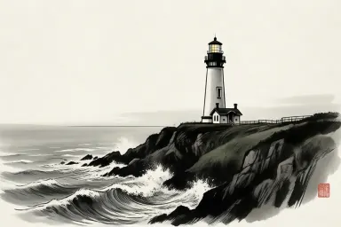 | **sumi-e** Japanese ink wash, brush strokes, lots of empty space | calm artwork, wellbeing, cultural content |
| 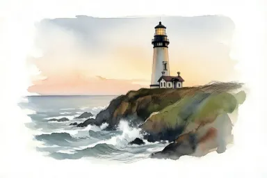 | **watercolor** Loose watercolour on textured paper, soft bleeding pigments | soft illustration, invitation, book cover |

## 3d

| Preview | Style | Use it for |
|---|---|---|
| 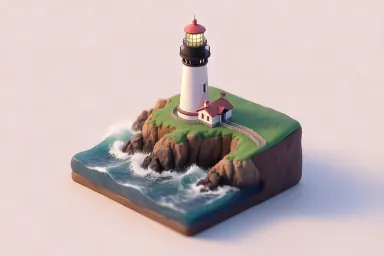 | **isometric-3d** Isometric 3D render, soft studio light, clay/plastic look | concept visual, process diagram, product explainer |

## craft

| Preview | Style | Use it for |
|---|---|---|
| 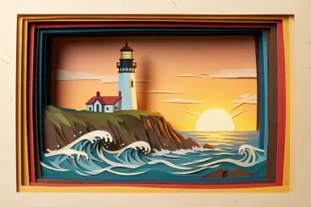 | **paper-cut** Layered paper-cut diorama with soft depth shadows | poster, packaging, editorial header |

## stylized

| Preview | Style | Use it for |
|---|---|---|
| 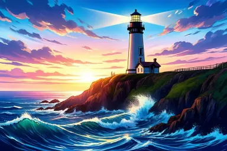 | **anime** Anime key visual, cel shading, vivid sky and light | key visual, game art, youth content |
| 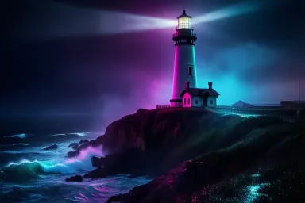 | **neon-cyberpunk** Night city, neon glow, wet reflections | tech event, gaming, sci-fi cover |
| 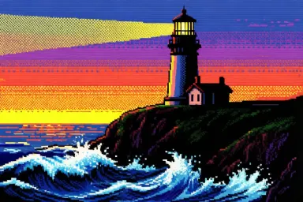 | **pixel-art** 16-bit pixel art scene, limited palette, crisp pixels | game, retro branding, avatar |

